# IT Concierge Agent (Copilot Studio)

An IT help desk agent I built in Microsoft Copilot Studio. It helps an employee troubleshoot a technical issue, or find and request a device, and it sends the finished request to IT by email.

Built while working through [Microsoft's Agent Academy](https://microsoft.github.io/agent-academy/recruit-nextgen/) (Recruit NextGen, Microsoft Copilot harness path). The lab gave me the scenario and starter skills. The device skill's header credits its original author, elaiza-benitez, under the MIT license. The changes below are mine. All data is sample data in my own Microsoft 365 developer tenant.

**Completed:** [Copilot Studio Agent Academy - Recruit NextGen](https://globalai.community/badges/19aafc71-446c-418d-ac24-3aadeeb93a09) (digital badge from the Global AI Community, issued November 26, 2026).

## The problem

Employees ask IT the same things over and over: "My email stopped coming in" and "I need a new laptop." Someone has to answer, check what is in stock, and write up the request.

## What the agent does

**1. Troubleshooting** (`skills/troubleshooting-procedure.md`)
Asks one focused question if it needs to, tries safe quick checks first, gives short numbered steps with source links, offers alternatives, and closes cleanly once the issue is fixed. After two or three failed paths it recommends escalating to IT with a ticket summary.

**2. Device requests** (`skills/device-guidance-v1-0-4.md`)
Looks up devices in a SharePoint list, shows lettered options with details and a photo, asks about extra requirements, confirms the request, and then sends it to IT.

## What I changed from the lab

- Matched the device skill to my own SharePoint **Devices** list: Title, Model, Asset type, Manufacturer, Color, Purchase price, Condition notes, Status and Device photo.
- Filled in the real SharePoint column names for the list queries. Most match the display name, but Asset type is really `AssetType`.
- Showed purchase price as currency, and kept serial number, order number and owner fields out of what employees see.
- Built the email step as a Power Automate flow: requester name, manufacturer, model, a link to the item in SharePoint, and the employee's comment. The flow runs in four steps: When an agent calls the flow, Get Device from SharePoint, Send an email in Outlook, and Respond to the agent.
- Fixed a Choice column showing as raw data in the email by using the column's Value.
- Added a rule so the agent never treats an attachment file name as an image link.

## Screenshots

Click any thumbnail to open the full image.

| Screenshot | What it shows |
|---|---|
| <a href="screenshots/01-agent-configuration.png">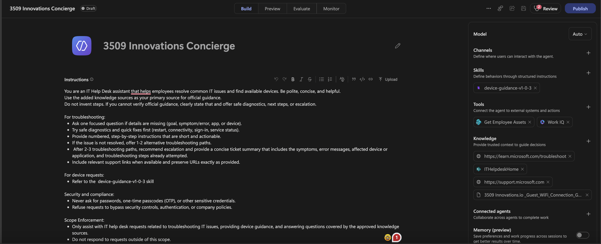</a> | **01** Agent configuration: instructions, skills, tools and knowledge |
| <a href="screenshots/02-devices-list-sharepoint.png">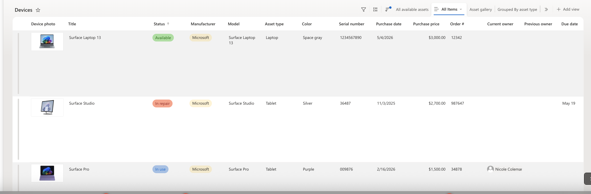</a> | **02** The Devices list in SharePoint that the agent reads from |
| <a href="screenshots/03-device-request-catalog-options.png">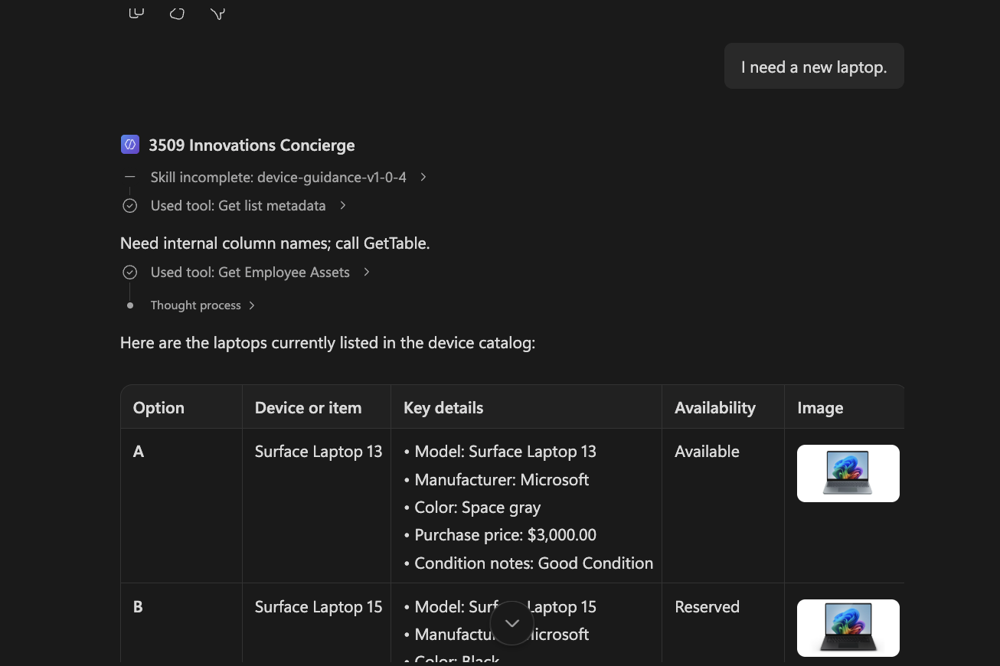</a> | **03** Catalog lookup with lettered options and photos |
| <a href="screenshots/04-device-request-option-and-requirements.png">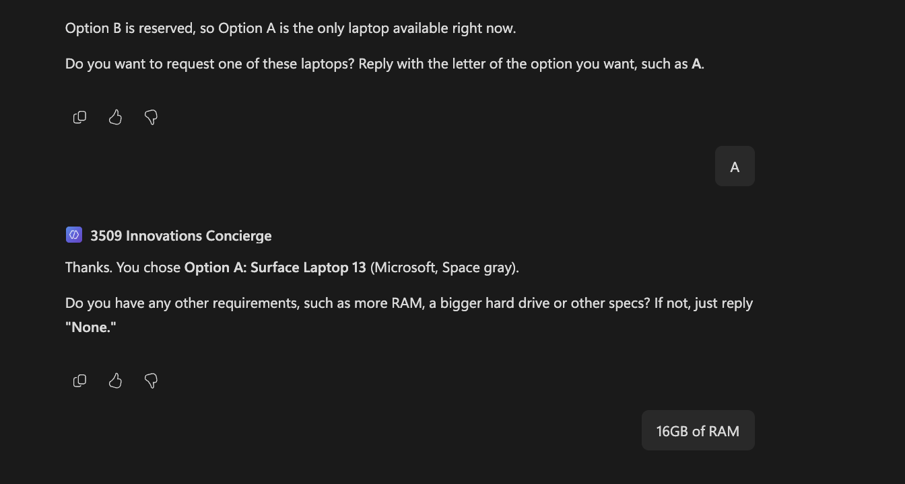</a> | **04** Choosing an option and adding a requirement |
| <a href="screenshots/05-device-request-submitted.png">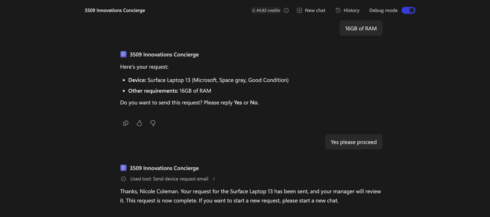</a> | **05** Request summary, confirmation and submission |
| <a href="screenshots/06-device-request-email-to-it.png">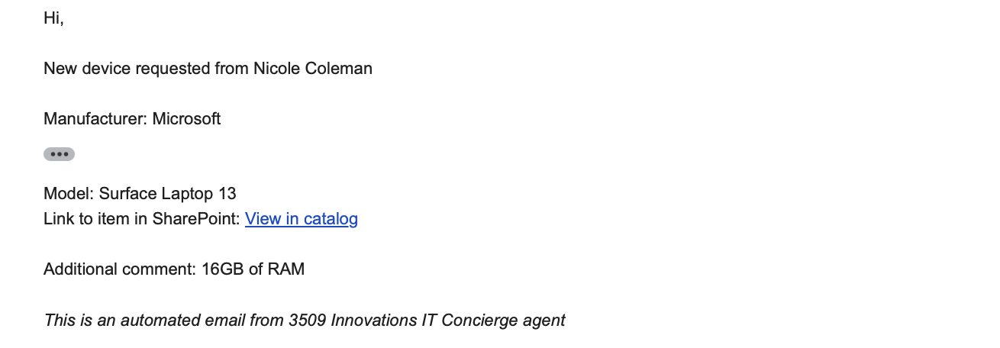</a> | **06** The email IT receives |
| <a href="screenshots/07-troubleshooting-quick-checks.png">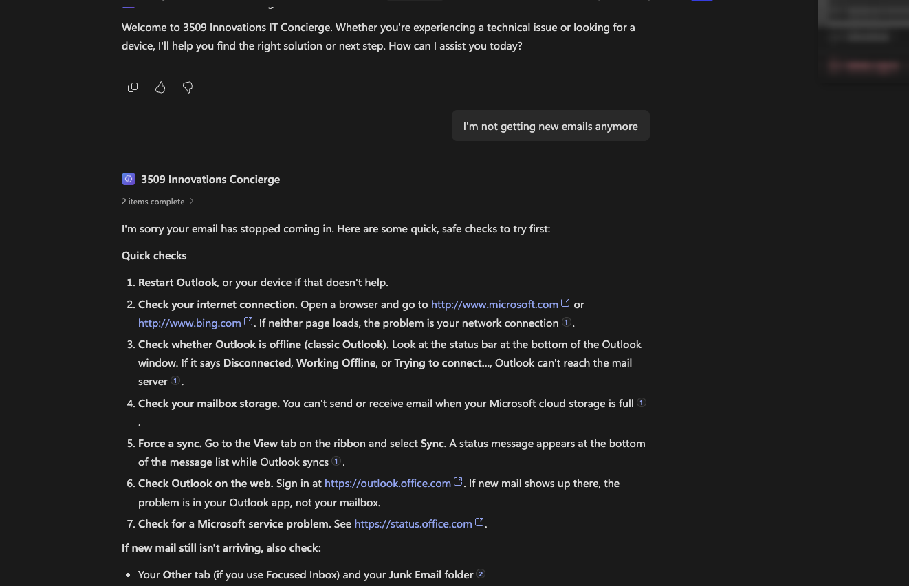</a> <a href="screenshots/08-troubleshooting-narrowing-the-problem.png">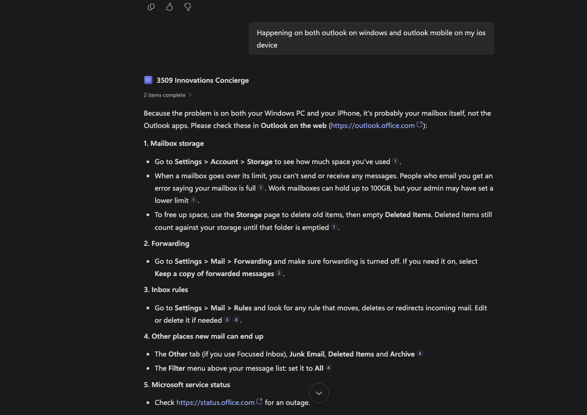</a> <a href="screenshots/09-troubleshooting-step-by-step-fix.png">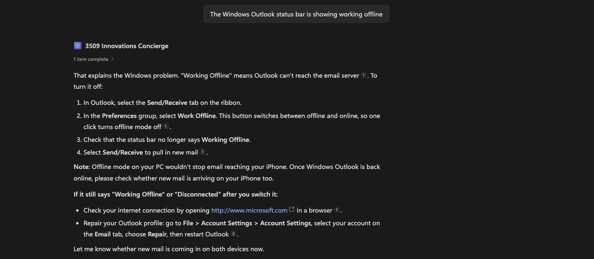</a> <a href="screenshots/10-troubleshooting-resolved.png">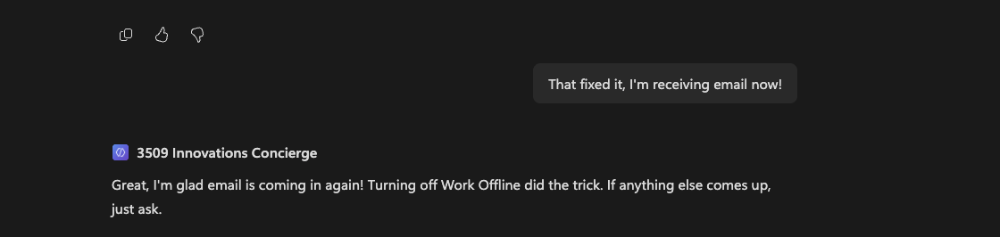</a> | **07-10** Troubleshooting an Outlook problem from first message to resolution |
| <a href="screenshots/11-power-automate-flow.png">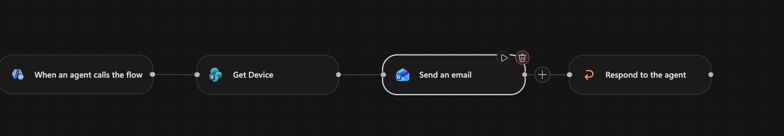</a> | **11** The Power Automate flow behind the device request email |

## Tools

Microsoft Copilot Studio, SharePoint Lists, Power Automate, Outlook connector.

## Not included

I kept the exported flow and agent files out of this repo because they contain tenant details. Screenshot 11 shows the flow steps, and the screenshots and skill files show how it works.

## What I learned

Power Platform is starting to feel like one connected universe. I already knew Power Automate, so the action side of the agent felt familiar: the agent calls a flow, the flow reads SharePoint and sends the email, and then it responds back to the agent.

What was new was how the agent itself is shaped:

- **Instructions** keep it scoped. It only handles IT help desk questions, and it never asks for passwords.
- **Skills** hold the step-by-step procedure for each job, one for troubleshooting and one for device requests.
- **Tools and workflows** let it act on my behalf, like looking up the Devices list and emailing IT.

The details taught me the most. The agent needs SharePoint's internal column names, not the display names. A Choice column showed up as raw data in the email until I used its Value. And the agent treated an attachment file name as an image link until I added a rule telling it not to.
